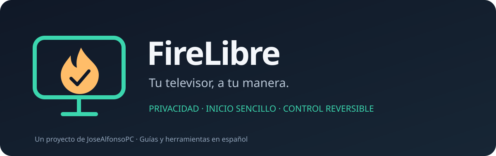

<p align="center"></p>

<p align="center">
  <a href="LICENSE"></a>
  <a href="https://github.com/JoseAlfonsoPC/firelibre/actions/workflows/ci.yml"></a>
  
  
</p>

# FireLibre

**Menos ruido. Más control. Un inicio sencillo para tu Fire TV.**

FireLibre es un proyecto de **JoseAlfonsoPC** para revisar y reducir componentes de métricas,
publicidad y aplicaciones auxiliares de Fire TV, conservar tus funciones habituales e integrar
un launcher ligero. Todo el flujo, los mensajes y las guías están en español.

Incluye un motor propio en Python sin dependencias de pip y la integración de **dumbtv Home
en español**, con su código fuente y créditos originales. Puedes trabajar con una guía manual
o dejar que Codex siga un procedimiento verificable.

**Versión inicial 0.1.0.** La lista de referencia y dumbtv se comprobaron en un Fire TV Stick
de 3.ª generación **AFTSSS, Fire OS 7 / Android 9**. El motor nuevo tiene pruebas de simulación
y diagnóstico real de solo lectura; su aplicación y restauración aún no se han ejecutado en
hardware con esta versión. Consulta la [cobertura exacta](docs/COMPATIBILIDAD.md).

## Elige tu camino

| Quiero… | Empieza aquí |
|---|---|
| Que Codex lo configure | [Prompt listo para copiar](prompts/CODEX.md) |
| Usar los scripts paso a paso | [Guía de inicio](docs/INICIO.md) |
| Entender y ejecutar las órdenes ADB | [Manual completo](docs/MANUAL.md) |
| Saber si mi equipo es compatible | [Dispositivos y límites](docs/COMPATIBILIDAD.md) |
| Elegir un launcher | [Launchers e integración](docs/LAUNCHERS.md) |
| Volver al estado anterior | [Restauración y recuperación](docs/RESTAURACION.md) |
| Ver qué se toca | [Perfiles y catálogo de paquetes](docs/PAQUETES.md) |
| Resolver problemas | [Solución de problemas](docs/SOLUCION-DE-PROBLEMAS.md) |

## Qué incluye

| Parte | Resultado |
|---|---|
| Diagnóstico e inventario | Modelo, versión Android, usuario activo y paquetes instalados. |
| Dos perfiles | Conservador: 8 candidatos. Equilibrado: 33. Solo se actúa sobre los que estén instalados y habilitados. |
| Plan antes de cambiar | Archivo JSON con cada operación, motivo y valores anteriores. |
| Diario de restauración | Se escribe antes de cada cambio y permite recuperarse de una interrupción. |
| Protección de funciones | Alexa, duplicación, actualizaciones, Appstore, mando, ajustes y streaming fuera de las listas de limpieza. |
| dumbtv en español | Menús, preferencias, mensajes y ayuda traducidos. Sin permiso de internet. |
| Home y autoinicio | Activación separada, prueba desde otra pantalla y comprobación tras reiniciar. Depende del firmware. |
| Documentación y pruebas | Guías, preguntas frecuentes, contribución, licencias y CI sin acceso a un televisor real. |

La limpieza usa `pm disable-user`; **no desinstala apps**. El inicio original de Amazon se mantiene
disponible. Reducir servicios y ajustes de recopilación **no demuestra ausencia total de telemetría**.
Los paquetes protegidos pueden seguir activos y los interruptores sincronizados se revisan también
con el mando. Más detalles en [Privacidad y red](docs/PRIVACIDAD.md).

## Inicio rápido

Necesitas Python **3.10 o posterior**, [Android Platform Tools](https://developer.android.com/tools/releases/platform-tools),
un ordenador en la misma red y ADB autorizado en el televisor. Sustituye siempre `192.0.2.10`
por la IP real de **tu** dispositivo. La dirección del ejemplo está reservada para documentación.

```bash
git clone https://github.com/JoseAlfonsoPC/firelibre.git
cd firelibre
adb connect 192.0.2.10:5555
python3 firelibre.py --serial 192.0.2.10:5555 doctor
python3 firelibre.py --serial 192.0.2.10:5555 plan --profile conservador --out state/plan.json
```

Lee `state/plan.json`. Cuando estés de acuerdo:

```bash
python3 firelibre.py --serial 192.0.2.10:5555 apply --plan state/plan.json --yes
```

La salida imprime una ruta como `state/FECHA-cleanup-ID/backup.json`. Usa **esa ruta exacta**:

```bash
python3 firelibre.py --serial 192.0.2.10:5555 verify --backup state/FECHA-cleanup-ID/backup.json
python3 firelibre.py --serial 192.0.2.10:5555 restore --backup state/FECHA-cleanup-ID/backup.json --yes
```

El último comando **deshace** esa sesión; ejecútalo solo si quieres restaurar. En Windows usa
`python` donde aparece `python3`, o los [wrappers incluidos](scripts/).

Para instalar el launcher y activar Home, sigue la [guía específica](docs/LAUNCHERS.md).
La limpieza no instala ni cambia el launcher automáticamente.

## Compatibilidad resumida

| Dispositivo / plataforma | FireLibre 0.1 |
|---|---|
| Fire TV Stick 3.ª gen **AFTSSS**, Android 9 / SDK 28 | Modelo de referencia; lista y launcher probados. Motor nuevo: simulación y diagnóstico real. |
| Otros Fire TV con SDK 25, 28, 29 o 30 | Diagnóstico; prueba de limpieza solo con `--experimental`. Activación Home propia a partir de SDK 28. |
| Fire TV antiguo con SDK 22 / Fire OS 5 | Solo diagnóstico; launcher integrado incompatible. |
| Fire OS 14/16, otros SDK | Solo diagnóstico; sin perfiles validados. |
| Fire TV con **Vega OS** | No compatible: no es Android. El nombre comercial Fire TV no basta. |
| Android TV / Google TV | Sin limpieza automatizada en esta versión. Consulta CleanYourTV y FLauncher. |
| Samsung Tizen, LG webOS, Roku, VIDAA | No compatible con estos scripts Android. |

La matriz detallada separa [soporte de compilación, funcionamiento y pruebas](docs/COMPATIBILIDAD.md).

## Un proyecto propio, con origen transparente

FireLibre reúne las ideas de diagnóstico por ADB, cambios reversibles y un inicio mínimo en una
herramienta nueva. Reconoce el trabajo de [CleanYourTV](https://github.com/Gathin23/cleanyourtv),
[dumbtv](https://github.com/humblemuzzu/dumbtv) y la
[guía de JLCareglio](https://gist.github.com/JLCareglio/881ab7feaa8013f838bec02c706b47a3).
El launcher integrado es una adaptación de dumbtv, no una creación desde cero de FireLibre.

[Origen y decisiones](docs/ORIGEN.md) · [Créditos y licencias](THIRD_PARTY_NOTICES.md) ·
[Arquitectura](docs/ARQUITECTURA.md) · [Desarrollo](CONTRIBUTING.md) · [Cambios](CHANGELOG.md) ·
[Seguridad](SECURITY.md) · [Preguntas frecuentes](docs/FAQ.md)

No se publican tus copias, IP, claves ADB, identificadores del dispositivo ni cuentas.
`state/`, compilaciones y claves de firma están excluidos de Git.
