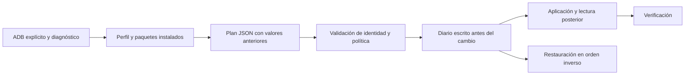

# Arquitectura y modelo de recuperación

[Índice](../README.md) · [Contribuir](../CONTRIBUTING.md)



## Organización

```text
firelibre/
├── firelibre.py                 Entrada portable
├── firelibre/                  Motor, ADB, CLI e integración Home
├── profiles/                   Perfiles y paquetes protegidos
├── integrations/
│   ├── launchers.json           Catálogo fijado de APK y referencias
│   └── dumbtv/                  Código MIT, recursos españoles y compilación
├── scripts/                    Wrappers y comprobación del repositorio
├── docs/                       Guías para personas y desarrolladores
├── prompts/                    Configurar, revisar y restaurar con Codex
├── tests/                      Simulador y pruebas de fallos/recuperación
├── .github/                    CI y plantillas
└── state/                      Estado privado, excluido de Git
```

## Planes y política

El plan contiene `schema`, propósito, perfil, identidad del dispositivo, firmware y operaciones.
Cada operación tiene un valor anterior y otro deseado. Antes de aplicar se vuelve a consultar
el dispositivo. Un cambio de identidad, firmware o estado invalida el plan.

El motor valida los paquetes contra el perfil y la lista protegida, y los ajustes contra sus
claves y valores permitidos. Los argumentos de ADB se envían como lista al proceso; las órdenes
del shell remoto se componen con `shlex.join`. No se ejecutan órdenes de shell arbitrarias
incluidas en un JSON.

La identidad local es un hash de un identificador estable leído del equipo. No es una
autenticación criptográfica del hardware ni hace anónimos los inventarios. La autorización
de transporte depende de ADB. Las copias no deben publicarse.

## Diario e interrupciones

Antes de cada cambio se guarda `attempted=true` y se sincroniza el archivo temporal antes de
reemplazar el diario. Tras verificar el resultado se añade `applied=true`. Si se pierde la
conexión entre ambos pasos, la restauración compara el valor real con el anterior y el aplicado.

Los valores ausentes se representan como JSON `null`. El texto literal `"null"`, si existe
como valor en `settings list`, sigue siendo texto y no se convierte en ausencia.
Un paquete inicialmente en estado `default` se restaura con `pm default-state`, no con `enable`.
Los que ya estaban deshabilitados se omiten del plan.

La recuperación no es una transacción global ni impide que otras apps escriban ajustes.
Los conflictos posteriores se conservan y se notifican. Las restauraciones de varias sesiones
se hacen desde la más reciente hacia atrás.

## Launcher y alcance

La instalación APK tiene un registro distinto y no se considera reversible por el mismo motor.
La activación de Guard sí registra los ajustes y la exención de batería que toca. No se cambia
el `set-home-activity` del sistema ni se deshabilita el launcher original.
El APK utiliza el mecanismo Guard de dumbtv en SDK 28+. La ruta Keeper para SDK 25 se
documenta como externa y no se automatiza en esta versión.

## Cobertura de pruebas

Las pruebas simulan cambio de dispositivo, estados anteriores, ausencias, fallos después de
escribir, conflictos de restauración, rechazo de paquetes protegidos, quoting y descarga con
hash incorrecto. La prueba real de diagnóstico detectó y corrigió la sintaxis antigua de
`settings list/delete` en Fire OS 7. Las pruebas de simulación no sustituyen una aplicación y
restauración en hardware; consulta [Compatibilidad](COMPATIBILIDAD.md).
