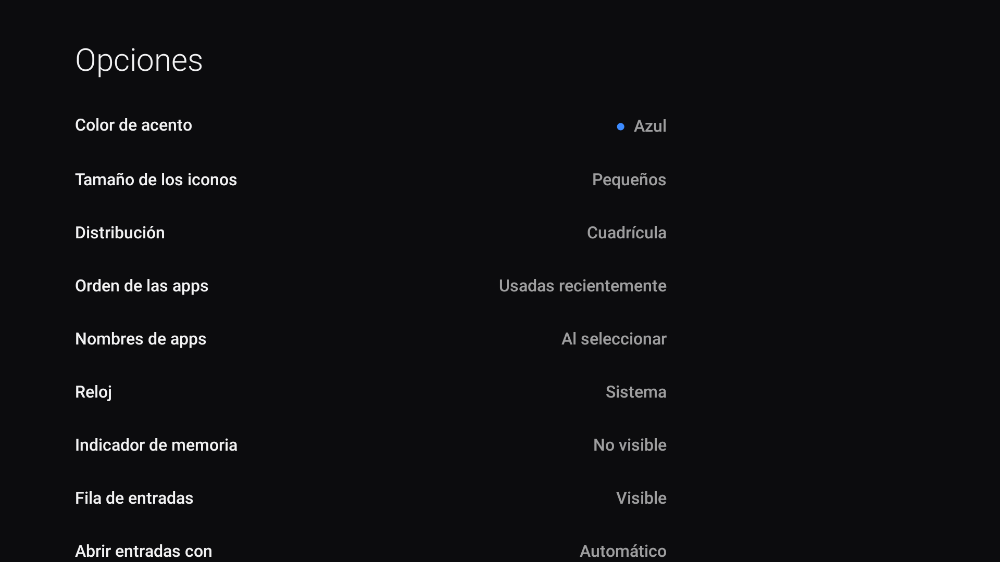

# Launchers: elegir, instalar e integrar

[Índice](../README.md) · [Compatibilidad](COMPATIBILIDAD.md) · [Restauración](RESTAURACION.md)

## Comparación y alcance

| Launcher | Para qué elegirlo | Integración en FireLibre |
|---|---|---|
| [dumbtv Home](https://github.com/humblemuzzu/dumbtv) | Inicio mínimo, apps, reloj, entradas y opciones; sin permiso de internet | Código español incluido, APK fijado, Guard, prueba de Home y autoinicio |
| [Projectivy Launcher](https://github.com/spocky/miproja1) | Categorías, canales, fondos y más personalización | Guía manual; no se redistribuye su APK ni se automatiza su accesibilidad |
| [CleanYourTV Home](https://github.com/Gathin23/cleanyourtv) | Interfaz y temas para Android TV/Google TV | Referencia externa; su documentación limita Fire TV a la limpieza |
| [FLauncher](https://gitlab.com/flauncher/flauncher) | Alternativa de código abierto para Android TV, desarrollada con Flutter | Referencia externa; Home en Fire TV no se ha validado aquí |
| [Leanback on Fire](https://github.com/tsynik/LeanbackLauncher) | Interfaz Leanback adaptada a Fire TV | Referencia externa; revisar firmware, versión y actividad del proyecto |

Instalar una app, abrirla al arrancar y capturar Home son **tres comportamientos diferentes**.
La versión Android mínima del APK no garantiza que Fire OS autorice la accesibilidad.
Elige un solo controlador de Home; no superpongas servicios de dos launchers.

## dumbtv en español, paso a paso

### 1. Descargar un APK verificado

Desde la raíz del proyecto:

```bash
python3 firelibre.py launcher list
python3 firelibre.py launcher download --id dumbtv-es --out dist/dumbtv-home-1.6-es.apk
```

La URL y SHA-256 están fijados en [`integrations/launchers.json`](../integrations/launchers.json).
Si la release todavía no estuviera disponible, compila desde el código incluido o espera a
que se publique; no sustituyas el enlace por una descarga de procedencia desconocida.

El SHA-256 de la versión española distribuida en 0.1.0 es:

```text
85f6b36cf0cd7a65c314b63685116e58ff9a93f8f60f257f55ce75b5ddd096df
```

La verificación prueba que recibiste el archivo esperado. La confianza en ese archivo sigue
dependiendo del proyecto y de la firma; el hash no convierte una descarga en una auditoría.

### 2. Instalar sin activar Home todavía

```bash
python3 firelibre.py --serial 192.0.2.10:5555 launcher install --apk dist/dumbtv-home-1.6-es.apk --sha256 85f6b36cf0cd7a65c314b63685116e58ff9a93f8f60f257f55ce75b5ddd096df --yes
```

Se usa `adb install -r` y se guarda una copia del APK previo si existía. **No se desinstala
automáticamente** una versión con otra firma. Si Android rechaza la actualización por firma,
consulta la migración al final de esta página. Este registro de instalación es distinto del
diario reversible de cambios; no se pasa al comando `restore`.

### 3. Activar Home de forma reversible

```bash
python3 firelibre.py --serial 192.0.2.10:5555 launcher activate --yes
```

Guarda la nueva ruta de `backup.json`, que corresponde a **la activación del launcher**.
El programa conserva otros servicios de accesibilidad, añade Guard y verifica que Fire OS
lo haya vinculado. Ajusta `min_futurity=0` conservando los demás parámetros y registra la
exención de batería. No elimina ni deshabilita el inicio de Amazon, ni cambia la preferencia
de Home del gestor de paquetes.

Si el firmware rechaza Guard, la ejecución informa del fallo y de la copia para restaurar.
No se interpreta una clave escrita en ajustes como prueba de que el servicio funcione.

### 4. Probar Home y autoinicio

```bash
python3 firelibre.py --serial 192.0.2.10:5555 launcher verify --test-home
python3 firelibre.py --serial 192.0.2.10:5555 launcher reboot-check --yes
```

La primera prueba abre Ajustes, sale de dumbtv y envía Home. La segunda reinicia una sola vez,
espera y lee la pantalla inicial **antes de abrir una app o enviar teclas**. Puede tardar
varios minutos. Después abre una app y pulsa Home con el mando físico. Documenta esa prueba
por separado: los scripts no pueden afirmar que tú hayas pulsado el botón.

### 5. Personalizar

En **Opciones** puedes elegir cuadrícula o filas, tamaño, color, nombres, orden por uso,
reloj, indicador de memoria y fondos. Los nombres de las apps los proporciona cada app;
traducir el launcher no traduce sus logotipos ni aplicaciones externas.



El archivo público de configuración, en los Fire OS que permiten acceder a él, es:

```text
/sdcard/Android/data/tv.dumbtv.home/files/home.conf
```

Los valores internos siguen en inglés para mantener compatibilidad con dumbtv. Por ejemplo,
`layout=grid`, `tiles=small`, `order=recent`. No traduzcas las claves del archivo.
El idioma visual sigue la configuración regional de Android; para español usa el idioma
español en el propio dispositivo. Se conservan los recursos ingleses como alternativa.

## Compilar la versión española

Necesitas JDK 17 recomendado, SDK Android con `platforms;android-25` y unas build-tools
compatibles. El proyecto se compiló también con JDK 21 y build-tools 36.0.0.

```bash
sdkmanager 'platforms;android-25' 'build-tools;36.0.0'
export ANDROID_HOME=/ruta/a/android-sdk
export JAVA_HOME=/ruta/a/jdk-17
bash scripts/build-launcher.sh
```

El APK aparece en `dist/`. En Windows, compila con WSL o Git Bash con el SDK/JDK accesible
desde ese entorno. La CLI Python de limpieza funciona sin Bash.

El script crea una clave local si no existe. **Conserva esa clave fuera de Git**: es necesaria
para actualizar tus propias compilaciones sin reinstalar. Para señalar una clave existente,
usa `DUMBTV_KEYSTORE` y `DUMBTV_KEYPASS` en el entorno. No copies claves a incidencias.
La compilación propia tendrá su propia firma y normalmente otro hash; se instala tras
revisar el manifiesto con `adb -s IP:5555 install -r RUTA.apk`. El instalador del catálogo
solo admite los APK fijados, y no incluye una opción para ignorar el hash.

## Migrar desde la versión oficial

La firma de la traducción es local y distinta de la oficial. Android rechazará una
actualización entre ambas. Antes de sustituir una instalación:

1. Guarda `home.conf`, fondos y cualquier otra configuración pública accesible.
2. Desactiva el controlador de Home siguiendo el registro de su propia instalación.
3. Comprueba que puedes abrir Ajustes y el inicio de Amazon.
4. Solo entonces decide si quieres desinstalar **únicamente** `tv.dumbtv.home` y reinstalar.
5. Restaura los archivos y vuelve a activar Guard con una nueva copia de restauración.

La desinstalación borra datos privados, incluido el historial de uso reciente. En Fire OS 8
ADB puede no permitir respaldar `Android/data`; no prometemos una migración sin pérdida.
La automatización de FireLibre se detiene ante una firma incompatible.

## Projectivy y otras integraciones

Para Projectivy utiliza las [releases de su autor](https://github.com/spocky/miproja1/releases)
y comprueba la versión mínima de Android. Configura desde su interfaz la sustitución de Home
y el arranque, si tu firmware lo permite. No pegues un `enabled_accessibility_services` que
borre VoiceView u otros servicios. Desactiva primero el controlador anterior y guarda su estado.

Otros launchers pueden instalarse y abrirse sin ser compatibles con Home automático. FireLibre
no utiliza un remapeador genérico que finja funcionar en cualquier modelo.
